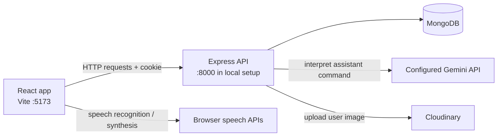

# Virtual Assistant

A browser-based, voice-enabled personal assistant built with React and an Express API. Users can create an account, choose an assistant name and image, and speak commands. The backend asks a configured Gemini-compatible API to interpret each command, then returns a response and (for supported command types) the browser opens a relevant search or website.

## 🌐 Live Demo

👉https://zyra-ai-tkla.onrender.com

---

## Key Features

- Account registration and sign-in using email and password.
- Cookie-based JWT authentication for user-specific API routes.
- Assistant setup with a built-in image or an uploaded image stored through Cloudinary.
- Browser speech recognition for voice input and speech synthesis for spoken responses.
- Voice commands are sent after the recognized transcript includes the configured assistant name.
- Assistant command interpretation through a configurable external Gemini API endpoint.
- Date, time, day, and month responses generated by the backend.
- Google and YouTube searches, plus links to calculator, Instagram, Facebook, and weather search.
- Per-user command history stored in MongoDB.

Voice input relies on the browser's Web Speech Recognition API and may not be available in every browser or context.

<!-- ## Demo and Screenshots

No public demo URL or screenshots are configured in the repository. -->

## Tech Stack

| Area | Technologies |
| --- | --- |
| Frontend | React 19, Vite 6, React Router, Tailwind CSS 4, Axios |
| Backend | Node.js, Express 5, Axios |
| Database | MongoDB with Mongoose |
| Authentication | JSON Web Tokens in HTTP-only cookies; bcryptjs password hashing |
| Integrations | Configurable Gemini API endpoint; Cloudinary image uploads |
| Browser features | Web Speech Recognition and Speech Synthesis APIs |
| Development tools | npm, Nodemon, ESLint |

## Architecture and Workflow

The Vite development server serves the React application. The frontend makes credentialed requests to the Express API, which validates the JWT cookie, reads or updates the user's MongoDB document, and delegates assistant commands to the configured external API. For uploaded images, the backend uses Multer for temporary local file handling and Cloudinary for storage.



The port labels above reflect the current local setup instructions. The backend defaults to port `5000`, while the frontend API URL is hard-coded to `http://localhost:8000`; set the backend's `PORT` to `8000` for the frontend and backend to communicate without changing source code. The backend CORS configuration currently accepts `http://localhost:5173`.

## Project Structure

```text
.
├── .env.example
├── README.md
├── backend/
│   ├── config/             # MongoDB, Cloudinary, and JWT configuration
│   ├── controllers/        # Authentication and user/assistant handlers
│   ├── middlewares/        # JWT authentication and Multer upload handling
│   ├── models/             # Mongoose user model
│   ├── public/             # Temporary upload destination
│   ├── routes/             # Authentication and user API routes
│   ├── gemini.js           # External assistant API integration
│   ├── index.js            # Express entry point
│   └── package.json
└── frontend/
    ├── public/
    ├── src/
    │   ├── assets/         # App images and animations
    │   ├── components/
    │   ├── context/        # Shared user state and API calls
    │   ├── pages/          # Sign-in, sign-up, customization, and home views
    │   ├── App.jsx         # Client-side routes
    │   └── main.jsx        # React entry point
    ├── index.html
    └── package.json
```

## Prerequisites

- Node.js and npm. The manifests do not declare a minimum Node.js version.
- A reachable MongoDB database (local or hosted).
- A Gemini API endpoint, model identifier, and API key for assistant command interpretation.
- Cloudinary credentials if users need to upload custom assistant images. Built-in images do not require an upload.
- A browser that supports the Web Speech Recognition API to use voice input.

## Installation and Setup

Run these commands in PowerShell from the repository root.

1. Install backend dependencies and create its local environment file:

   ```powershell
   Set-Location backend
   npm ci
   Copy-Item ..\.env.example .env
   ```

2. Edit `backend\.env` with your database and API credentials. Set `PORT=8000` to match the frontend's configured API base URL. `PORT=5000` is the backend's standalone default, but the frontend will not reach that port unless its source configuration is changed.

3. Install frontend dependencies in a second terminal:

   ```powershell
   Set-Location frontend
   npm ci
   ```

4. Start MongoDB and ensure the connection string in `backend\.env` points to it.

The backend loads `.env` from its current working directory; create `backend\.env` rather than a root `.env`. The root `.env.example` is the template for this file.

## Environment Variables

The complete template is [`.env.example`](./.env.example). Keep actual credentials in the ignored `backend\.env` file, not in source code or frontend variables.

| Variable | Required when | Purpose |
| --- | --- | --- |
| `PORT` | Optional | Backend listen port. Defaults to `5000`; use `8000` with the current frontend API URL. |
| `MONGODB_URL` | Always for database-backed operation | MongoDB connection string used by Mongoose. |
| `JWT_SECRET` | Authentication is used | Secret used to sign and verify JWTs. Set a strong, unique value. |
| `CLOUDINARY_CLOUD_NAME` | Uploading a custom image | Cloudinary account cloud name. |
| `CLOUDINARY_API_KEY` | Uploading a custom image | Cloudinary API key. |
| `CLOUDINARY_API_SECRET` | Uploading a custom image | Private Cloudinary API secret. |
| `GEMINI_API_URL` | Assistant requests are used | Full request URL for the configured Gemini-compatible API. No default is defined in source. |
| `GEMINI_MODEL` | Assistant requests are used | Model identifier sent in the request body. No default is defined in source. |
| `GEMINI_API_KEY` | Assistant requests are used | API key sent in the `x-goog-api-key` request header. Keep it private. |

Cloudinary and Gemini configuration is read from the backend process environment. Do not add these private values to Vite's public frontend environment.

## Running the Project

Start each process in its own PowerShell terminal.

Backend development server (runs Nodemon):

```powershell
Set-Location backend
npm run dev
```

Frontend development server (Vite, normally at `http://localhost:5173`):

```powershell
Set-Location frontend
npm run dev
```

Frontend production build and local preview:

```powershell
Set-Location frontend
npm run build
npm run preview
```

The backend has no build step. Use `npm run dev` for local development or `npm start` for production; both run `index.js`.

## Render Backend Deployment

Configure the Render web service to use `backend` as its root directory, `npm ci` as its build command, and `npm start` as its start command. The backend connects to MongoDB before opening its HTTP listener and exits with an error if the database connection cannot be established.

Set these backend service environment variables in Render:

| Variable | Required | Purpose |
| --- | --- | --- |
| `MONGODB_URL` | Yes | MongoDB connection URI used by Mongoose. |
| `JWT_SECRET` | Yes | Secret used to sign and verify authentication cookies. |
| `PORT` | No | Render supplies this automatically; the backend also defaults to `5000` for local use. |

In MongoDB Atlas, ensure the database user and password in `MONGODB_URL` are valid and URL-encode any special characters in the username or password. Add the Render service's outbound IP addresses to Atlas **Network Access**. If Render's outbound addresses can change for your service, use a supported stable-egress option or update the Atlas access list; only use a broad `0.0.0.0/0` rule if its security implications are acceptable.

## API

All endpoints are mounted under `/api`. Except for sign-up, sign-in, and logout, the routes require the `token` cookie issued during authentication. The frontend sends requests with credentials enabled.

| Method | Endpoint | Purpose | Authentication | Request | Success response |
| --- | --- | --- | --- | --- | --- |
| `POST` | `/api/auth/signup` | Create an account | No | JSON: `{ "name": "...", "email": "...", "password": "..." }` | `201`; user document and sets the `token` cookie. Passwords shorter than six characters and duplicate emails are rejected. |
| `POST` | `/api/auth/signin` | Sign in | No | JSON: `{ "email": "...", "password": "..." }` | `200`; user document and sets the `token` cookie. |
| `GET` | `/api/auth/logout` | Sign out | No | None | `200`; `{ "message": "log out successfully" }`, and clears the cookie. |
| `GET` | `/api/user/current` | Retrieve the current user | Yes | None | `200`; current user document without the password field. |
| `POST` | `/api/user/update` | Set the assistant name and image | Yes | `multipart/form-data`: `assistantName` and either `imageUrl` or `assistantImage` file | `200`; updated user document without the password field. |
| `POST` | `/api/user/asktoassistant` | Interpret a user command | Yes | JSON: `{ "command": "..." }` | `200`; `{ "type": "...", "userInput": "...", "response": "..." }` for recognized command types. |

The assistant response `type` may be `general`, `google-search`, `youtube-search`, `youtube-play`, `get-time`, `get-date`, `get-day`, `get-month`, `calculator-open`, `instagram-open`, `facebook-open`, or `weather-show`. The frontend handles those types by speaking the response and, where applicable, opening the related website or search.

Authentication errors, invalid credentials, and invalid assistant responses return error status codes with a JSON `message` or `response`; exact error details depend on the route.

**Security note:** The current sign-up and sign-in handlers return the full Mongoose user document, which includes the stored bcrypt password hash. Do not expose this API publicly without changing those handlers to exclude the password field from their responses.

## Database

The backend connects to MongoDB using `MONGODB_URL`. Mongoose creates/uses the `User` model with name, email, password hash, assistant name/image, command history, and automatic timestamps. There are no migration or seed scripts in the repository; create or provide a MongoDB database and the application will create its collection through normal Mongoose model use.


## Contributing

Contributions are welcome. Fork the repository, create a focused branch, make and verify your change, and open a pull request with a concise description. Include or update tests if a test setup is added to the project.


## Author
This project was built by Md Tufail.

- Role: B.Tech Computer Science student with a passion for software development and building interactive web applications.

- Connect:
    - LinkedIn: linkedin.com/in/tufailmd
    - GitHub: github.com/TufailMd
    - Email: jrtufailmd@gmail.com